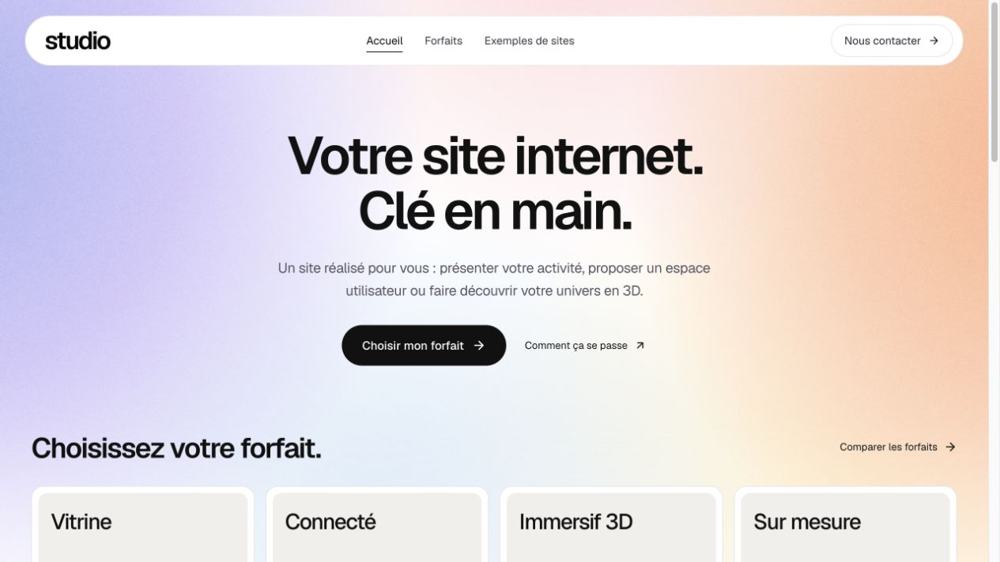
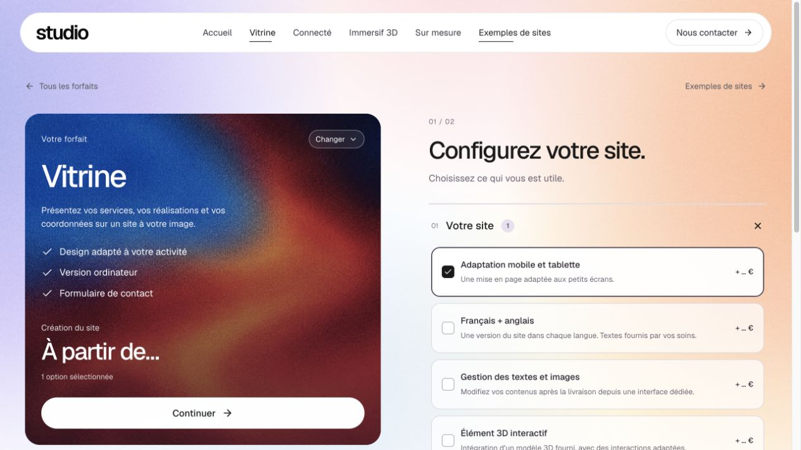
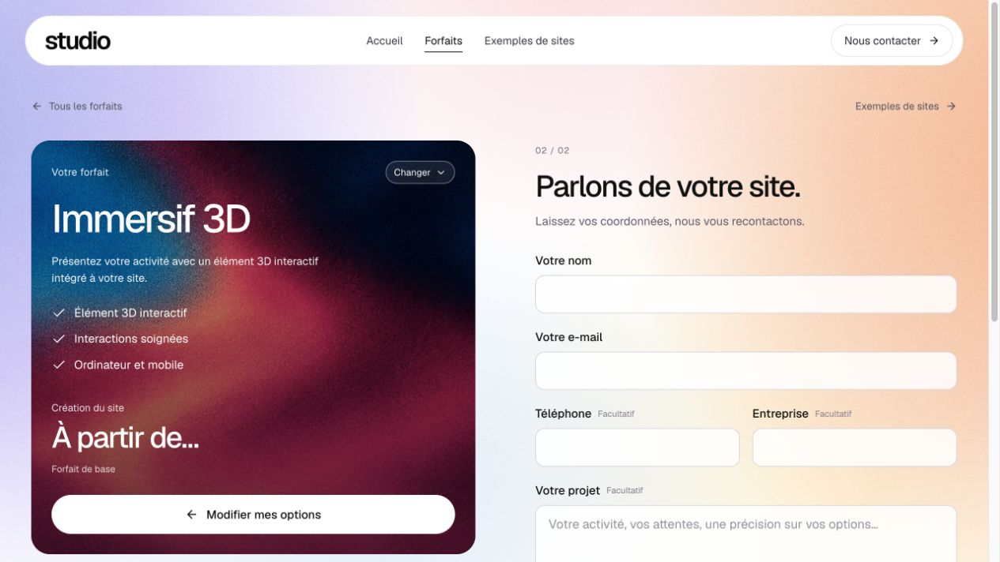
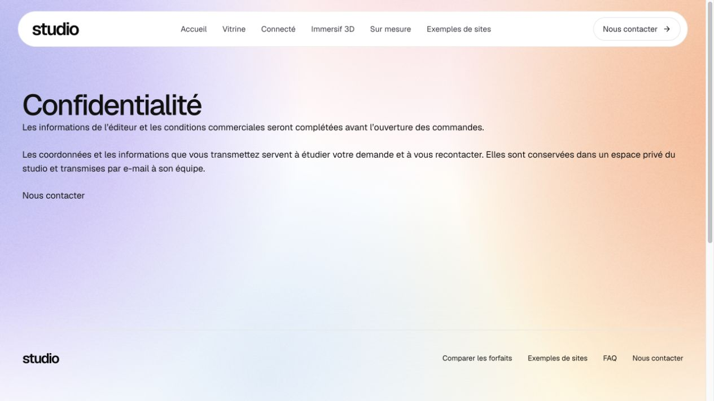
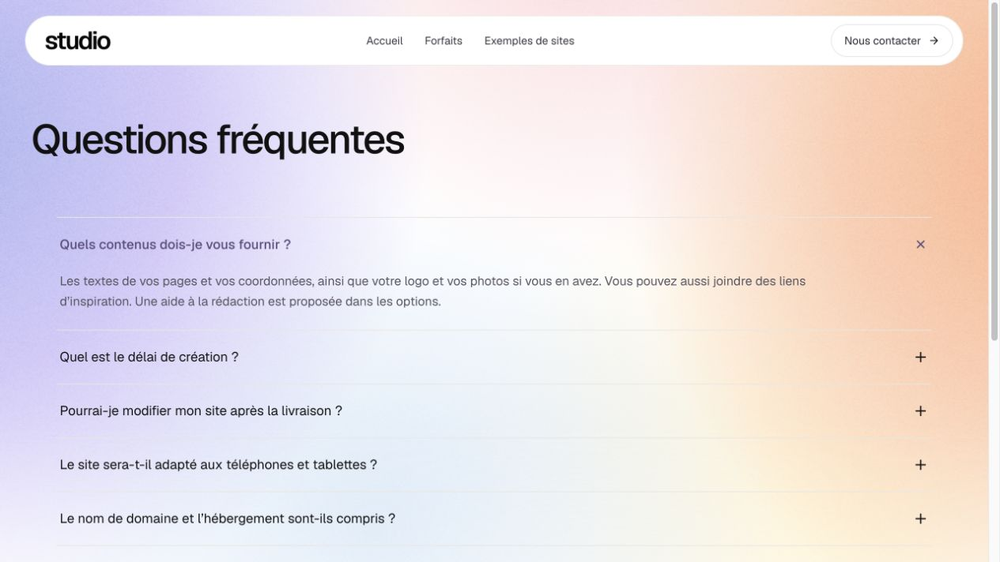
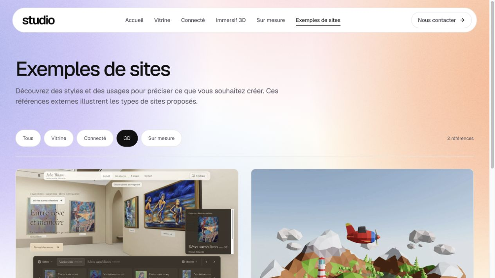

# Revue du site studio — 2 novembre 2026

Mise à jour du 3 novembre : galerie compacte et scroll stable, dix références classées sans doublon, garde de sortie des briefs et fondations SEO publiés dans `099c1a1`. Revue de trois spécialistes, contrôles HTTPS et IAB desktop/mobile terminés ; 202 tests réussis. Le corps ci-dessous est historique. État actuel : [SUIVI_DEMANDES.md](SUIVI_DEMANDES.md) et [revue finale](qa/gallery-review/final-review.md).

Revue du parcours public sur gilmathis.com, puis vérification locale des corrections demandées. Captures réalisées pendant cette revue, sur ordinateur et mobile. Aucun formulaire n’a été envoyé et aucun e-mail de test n’a été émis.

## 1. Accueil — navigation et textes allégés

La barre proposait une destination par forfait, en plus de l’accueil et de la galerie. Elle propose désormais Accueil, Forfaits, Exemples de sites et Nous contacter. Le menu mobile reprend ces quatre destinations sans sous-menu. Le lien Forfaits permet toujours de rejoindre chaque configuration par le comparatif.

Les badges « Un interlocuteur direct », « Un périmètre validé ensemble » et « Sans compte à créer » ont été retirés. Le hero conserve le service vendu et ses deux actions. Les cartes remontent naturellement après suppression de cette ligne ; leur matière et leur effet restent identiques.

## 2. Configuration — parcours fonctionnel, offre commerciale à préciser

Le choix d’un forfait, les options et le passage aux coordonnées fonctionnent dans le parcours inspecté. Le chemin Navigation → Forfaits → Configurer Immersif 3D → Coordonnées a été vérifié après simplification de la barre. Les formulations sur l’absence de compte ont été retirées du configurateur et du contact.

**À compléter :** les tarifs de base et d’options sont toujours absents. Contrôle du catalogue public : 0 montant défini sur 4 bases et 0 sur 26 options. Il faut également arrêter le nombre de pages, les retours compris, les délais et les limites des interventions : aucune de ces valeurs n’a été inventée dans cette correction.

## 3. Demande — formulaire accessible, réception à terminer

Les champs nom et e-mail sont identifiables ; téléphone, entreprise et précisions sont facultatifs. Le retour aux options reste visible. La réouverture et l’affichage ont été vérifiés sans soumettre de demande en production.

**À terminer :** la destination des notifications e-mail n’est pas encore configurée. Sa présence a été vérifiée côté serveur, sans afficher sa valeur ni les secrets. Le système conserve les demandes, mais cette revue ne prouve ni envoi ni réception réelle. Mathis a déjà indiqué qu’il fournirait l’adresse plus tard ; aucune nouvelle demande de cette information n’a été faite.

## 4. Informations commerciales — encore provisoires

La page Confidentialité accessible depuis le formulaire affiche encore le texte annonçant que les informations de l’éditeur et les conditions seront complétées. Les routes Informations légales et Conditions utilisent aussi un contenu provisoire.

**À compléter :** identité du vendeur, conditions de prestation et de livraison, droits et responsabilités, présentation du traitement des coordonnées. La revue constate l’état du site ; elle ne constitue pas une validation juridique. Aucun engagement ou renseignement d’entreprise n’a été inventé.

## 5. FAQ — six questions de décision

Les questions sur « À partir de », le cumul d’options et « Je n’y connais rien » ont été remplacées par : contenus à fournir, délai, modifications après livraison, adaptation mobile, domaine/hébergement et maintenance. Les trois premières sont aussi celles de l’accueil. Aucun délai chiffré ni service gratuit non validé n’est promis.

L’ouverture des réponses et le menu ont été testés. Sur mobile 390 × 844 CSS : aucune largeur excédentaire (document et zone client à 375 px) ; les questions longues reviennent à la ligne. L’état ouvert est exposé par aria-expanded. Le viewport d’essai a été réinitialisé.

## 6. Galerie — références explicites, preuves propres au studio à ajouter

Les sources externes sont annoncées et créditées. Le filtre 3D affiche bien deux références, Julie Thiam et Tiny Heaven ; leurs aperçus sont chargés. Aucune scène distante n’est automatiquement lancée.

**Amélioration utile pour la crédibilité :** ajouter des études de cas de réalisations propres au studio, avec le besoin, le résultat et un lien réel, lorsque ces éléments sont disponibles. Les références externes actuelles expliquent des styles ; elles ne prouvent pas des relations clients du studio. Aucun avis, chiffre de clients ou rabais non justifié n’a été ajouté.

## Texture : essai en définition supérieure non retenu

Un essai image_gen depuis la source originale a été demandé en 3072 × 2048. La sortie réelle reste 1536 × 1024 et modifie la microtexture et certaines limites de couleur. Il n’y a donc aucun gain réel de résolution. L’essai est archivé hors du build public dans `asset-sources/textures/detail-trial-20261102/`. Le master sans perte approuvé est conservé ; aucun faux agrandissement n’est présenté comme davantage de détails.

## Priorités restantes et limites de la revue

1. Finaliser les prix et le périmètre concret des forfaits : pages, retours, délais, livraison et services mensuels.
2. Terminer la réception des demandes, puis vérifier un envoi et une réception réels lorsque le destinataire sera fourni.
3. Remplacer les pages commerciales provisoires par les informations validées du studio.
4. Ajouter ensuite des preuves de travail propres au studio.

Cette revue couvre l’affichage et les interactions décrites, pas un audit de sécurité, une certification d’accessibilité, une étude juridique ou un envoi réel. Les captures transitoires ou avec des images encore en cours de chargement ont été remplacées par les états stabilisés. TypeScript, build et 113 tests passent ; aucune erreur/alerte applicative observée dans la console locale finale.

## Vérification de publication

Corrections d’interface publiées et vérifiées sur gilmathis.com, révision `d892e663fcb744d485f0e1621efaa560cf4dc738`. La navigation observée correspond au menu simplifié ; la FAQ affiche les six nouvelles questions et aucune des formulations retirées. Capture de l’accueil : `qa/navigation-content-review/after-public-home-retina.png` ; FAQ : `qa/navigation-content-review/after-public-faq-retina.png`. Les éléments à compléter dans les étapes 2, 3 et 4 restent ouverts : cette publication ne valide pas encore les tarifs, l’offre commerciale ou une réception e-mail.
