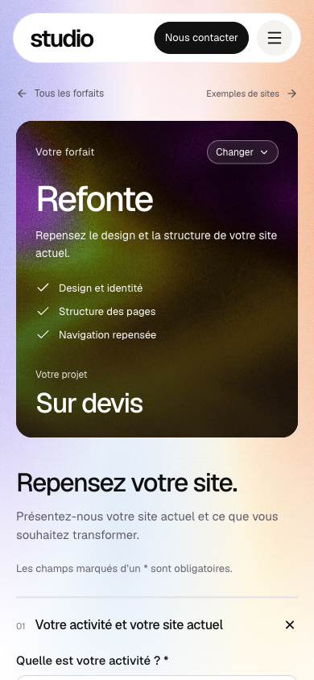
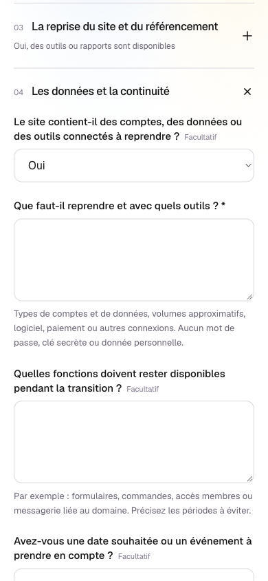
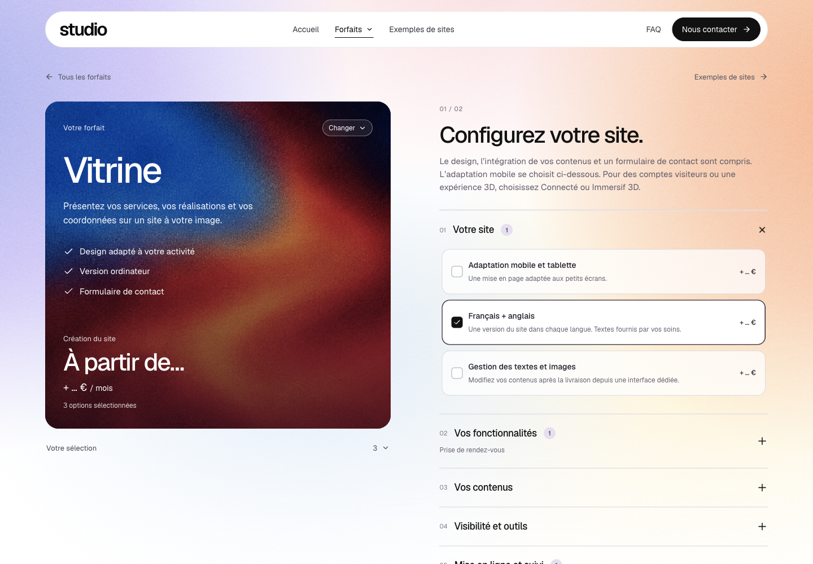

# Revue UX des briefs V2

Revue locale du 3 novembre 2026, dans un onglet IAB caché et indépendant. Aucun code modifié, aucune soumission et aucun envoi d’e-mail. Lecture des six parcours, de leurs rubriques et des branches indiquées ci-dessous. État observé pendant le travail local ; aucune conclusion de production.

## Parcours vérifiés

| Étape | Parcours | État général et preuve observée |
| --- | --- | --- |
| 1 | Vitrine | Cohérent. 12 options : 3 / 1 / 4 / 1 / 3 dans les cinq rubriques. Activité, cible, action prioritaire, pages, contenus, mise en place et contraintes sont compréhensibles. |
| 2 | Connecté | Cohérent. 12 options : 1 / 4 / 3 / 1 / 3. Profils, actions, inscription, droits, champs des données, validations, imports et intégrations sont distingués. |
| 3 | Immersif 3D | Cohérent. 12 options : 2 / 1 / 5 / 1 / 3. Objet, utilité de la 3D, état du modèle, interactions, variantes et emplacement sont couverts. Choisir un modèle disponible fait apparaître format, poids, textures, animations et droit d’usage. |
| 4 | Sur mesure | Cohérent, avec un petit doublon. 10 options : 2 / 2 / 2 / 1 / 3. Cas d’usage, acteurs, données, outils, priorités et résultat attendu structurent bien la demande. |
| 5 | Évolution | Cohérent. L’existant, les changements précis et les éléments à conserver sont demandés. Les accès disponibles sont distingués des identifiants à ne pas transmettre. |
| 6 | Refonte | Bonne couverture technique. Existant, problèmes, éléments conservés, nouvelle structure, contenus à reprendre, plateforme, accès, URL/redirections, référencement, données et continuité sont demandés. Deux compléments proposés ci-dessous. |

## Constats et suite donnée

Après cette revue, le coordinateur indique avoir traité les points 1 à 3 : références visuelles en Refonte, précision conditionnelle de l’autre plateforme et aide sur l’événement / les informations / l’action d’intégration. Ces petites corrections n’ont pas été revérifiées dans cet onglet, déjà fermé. Les constats ci-dessous décrivent donc l’état observé avant ces corrections. Le point 4 reste une suggestion mineure de rédaction.

1. **P2 — Refonte : recueillir la direction visuelle souhaitée.** La carte promet « Design et identité », mais les quatre rubriques du brief ne proposent ni références visuelles, ni nouvelle identité ou style souhaité. La question sur les problèmes actuels et celle sur la structure ne suffisent pas à distinguer une modernisation visuelle d’un changement complet d’identité. Réutiliser une question facultative de références avec ce que le client souhaite conserver ou faire évoluer. Cette question existe déjà dans les autres parcours concernés.
2. **P3 — Évolution / Refonte : préciser la plateforme “autre”.** Le choix « Un autre outil » ne révèle aucun champ demandant son nom. L’équipe reçoit donc une catégorie sans information exploitable pour préparer la reprise. Ajouter un court complément facultatif « Quel outil ? », avec possibilité d’incertitude.
3. **P3 — Connecté / Sur mesure : mieux cadrer l’intégration.** L’aide de « Quels outils doivent échanger avec le site ? » dit que le nom de l’outil suffit. C’est accessible, mais cela ne sollicite pas l’événement, les informations échangées et l’action attendue annoncés par la recherche. Une aide facultative simple, par exemple « Lorsqu’un rendez-vous est confirmé, envoyer sa date et le contact vers votre agenda », donnerait une meilleure base de devis sans jargon.
4. **P3 — Sur mesure : réduire le doublon scénario / étapes.** « Décrivez une utilisation du début à la fin » puis « Quelles étapes ou validations sont nécessaires ? » invitent à répéter le même parcours. Conserver la seconde pour les exceptions ou validations particulières, ou préciser ce qu’elle ajoute au scénario.

Aucun blocage fonctionnel constaté dans le périmètre parcouru.

## Points validés

- Une seule rubrique ouverte à la fois, possibilité de la refermer, et résumés des choix/réponses dans les rubriques fermées. Les exemples des questions sont concrets ; les choix techniques proposent « Je ne sais pas » / « À définir ensemble » ou restent facultatifs.
- Prénom, nom, e-mail et téléphone : `required=true` constaté dans le DOM Vitrine et Refonte, types `text`, `text`, `email`, `tel` et autocomplete adaptés. Entreprise facultative.
- Vitrine : après saisie fictive de l’activité, de la cible, de l’action, des pages et des quatre coordonnées, ajout client du fichier public `card-grain.webp`, puis « Modifier mes options » → « Décrire mon projet » : réponses, coordonnées et image restaient affichées. Aucun clic sur « Envoyer ma demande ».
- Branches Refonte : « outils ou rapports disponibles » révèle le détail SEO ; « comptes, données ou outils à reprendre : Oui » révèle types de données, volumes et connexions. La continuité cite aussi la messagerie du domaine et les périodes à éviter.
- Refonte mobile : viewport CSS **390 × 844**, largeur du document **390**, aucun contrôle visible hors largeur. Geist confirmé par style calculé. Les captures montrent des champs et aides lisibles. Ce contrôle ne constitue pas une certification d’accessibilité.

## Captures et limites

Captures natives CDP `fromSurface:true`, avec clip explicite, enregistrées puis réouvertes pour inspection. Les premières captures sans clip étaient tronquées et ont été rejetées.

Les interactions et les textes des six parcours ont été contrôlés par AX/DOM ; les preuves visuelles retenues couvrent Vitrine ordinateur et Refonte mobile. Pas de validation par envoi, de contrôle d’e-mail, de lecture d’une demande créée ni de test serveur dans cette revue. L’onglet créé pour la revue a été fermé et son override de viewport retiré ; aucun onglet utilisateur ou de coordination n’a été manipulé.

## Clôture parent

Les points 1 à 4 sont intégrés : références visuelles Refonte, nom de plateforme conditionnel, précision des échanges entre outils et question Sur mesure recentrée sur les validations et exceptions. Le dernier ajustement ne change que le libellé et l’aide de la question existante. Le parent a aussi vérifié le parcours complet Refonte dans une base locale isolée : refus des coordonnées vides et du téléphone invalide, enregistrement avec une image PNG, connexion administrateur fictive, consultation des rubriques et miniature chargée à 640 px. Aucune notification réelle (zéro tentative). Preuves : local-admin.txt et local-admin-image.png.
