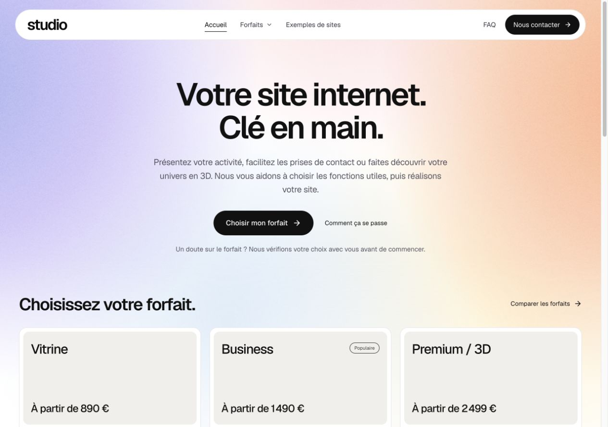
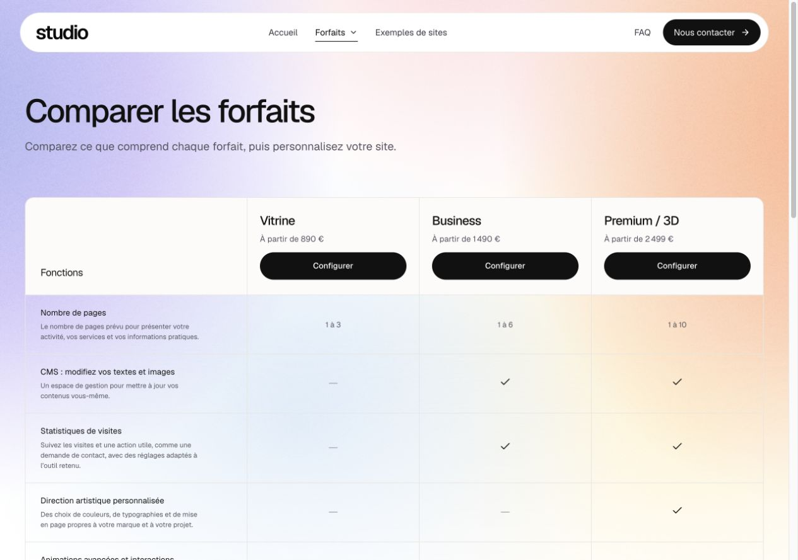
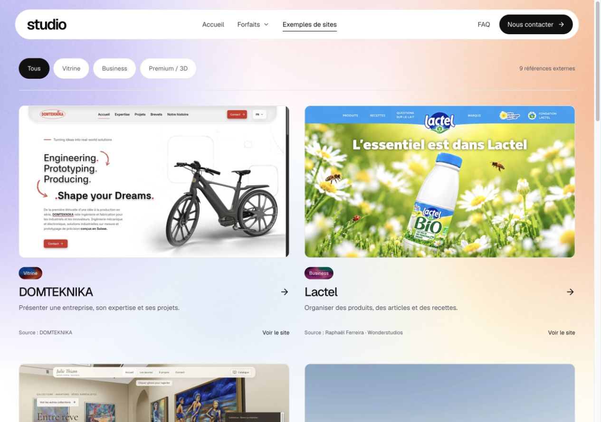
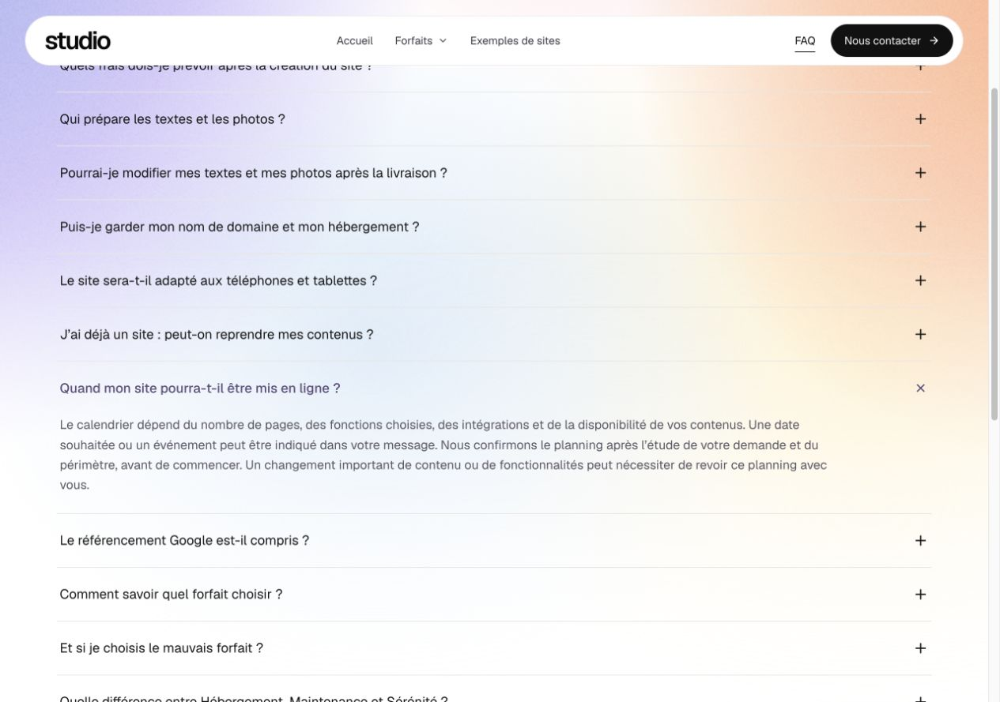
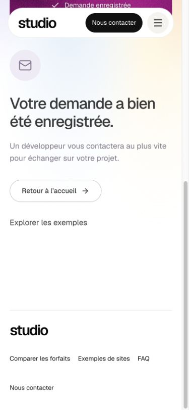
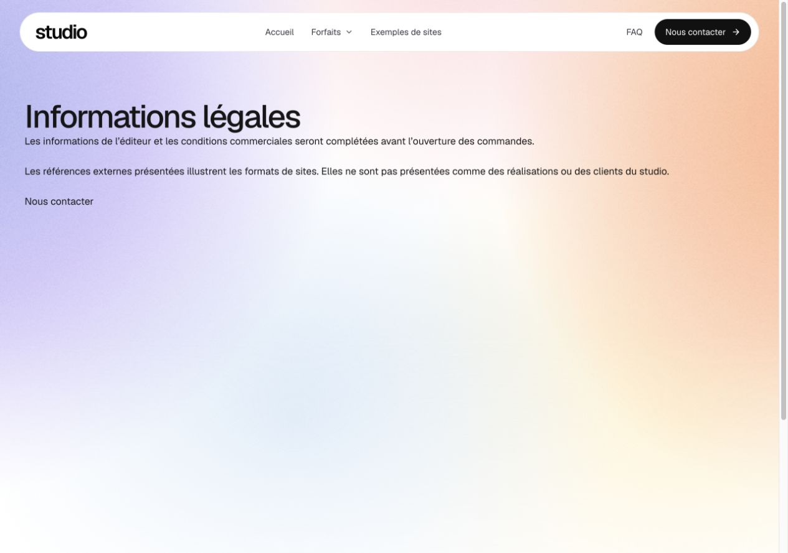

> Mise à jour après correction : les deux défauts techniques, les quantités de pages supplémentaires et les limites des options ont été traités dans le lot suivant. Voir [les corrections et leurs preuves](../fixes-2026-11-06/REVIEW.md). Ce document conserve les constats de la revue initiale ; les besoins de destinataire e-mail, d’identité éditoriale et de suivi des coûts restent distincts.

# Revue critique de gilmathis.com — 6 novembre 2026

**Verdict : les trois offres sont plus lisibles et le parcours normal fonctionne. Le site doit encore renforcer la prise en charge des demandes, l’identité du prestataire et les preuves de son travail avant de soutenir une acquisition commerciale régulière.** Les prochains efforts les plus utiles portent sur ces points, puis sur le périmètre des prestations et la robustesse en cas de panne.

Cette revue rassemble trois relectures spécialisées, les contrôles du coordinateur dans le navigateur intégré, des scénarios de prix exécutés sur le catalogue et six sources primaires consultées aujourd’hui. Elle distingue les corrections demandées, les défauts vérifiés, les risques d’interprétation et les décisions commerciales encore nécessaires. Les prix restent ceux de Mathis. Aucun taux de conversion, délai de livraison, client, avis, coût horaire ou bénéfice n’a été inventé.

## Corrections de cette livraison

- « Galerie, tarifs et témoignages » devient **« Photos de réalisations, tarifs et avis clients »**.
- Les **15 fonctions du comparatif** ont une description : ce qu’elles permettent de faire, avec les limites utiles. Les descriptions ne répètent plus dans quels forfaits elles sont comprises : les colonnes et leurs coches donnent cette information.
- **Business et Premium expliquent le CMS** : un espace de gestion pour modifier soi-même les textes et les images. L’option Vitrine s’appelle « Modifier mes contenus (CMS) ». Le comparatif et les FAQ correspondantes emploient le même vocabulaire.
- Le vocabulaire technique est simplifié : éléments 3D, référencement, mise en ligne. Les prix, pages 3/6/10, inclusions, textures et interactions approuvées sont conservés.
- Le formulaire commun demande **« Décrivez brièvement votre projet »**, avec une aide courte.
- Après une réponse API confirmant l’enregistrement, les deux parcours affichent **« Votre demande a bien été enregistrée. Un développeur vous contactera au plus vite pour échanger sur votre projet. »** Cette phrase ne prétend pas qu’un e-mail a été livré. La prise en charge réelle reste à organiser.

Publication : voir le compte rendu de livraison à la fin de ce rapport. Les captures « avant » documentent les constats de cette revue ; elles ne représentent pas les textes finaux.

## Les priorités, par effet sur le client et sur l’activité

| Priorité | Constat actuel | Effet possible | Action concrète et preuve de clôture |
| --- | --- | --- | --- |
| **1 — avant acquisition** | **Destinataire des notifications absent.** Contrôle SSH du 6 novembre : clé et expéditeur présents, `INQUIRY_TO` absent. L’API conserve les demandes mais ne peut pas envoyer l’alerte prévue. | Un prospect voit sa demande enregistrée, mais l’équipe peut ne pas la remarquer rapidement. | Renseigner le destinataire réel lorsqu’il sera fourni ; vérifier une réception autorisée et la prise en charge. Entre-temps, affecter la lecture de l’administration à une personne. Une confirmation ou un test simulé ne prouve pas la réception. |
| **1 — avant acquisition** | **Identité, informations légales et confidentialité incomplètes**, footer sans accès légal. La page affiche elle-même son caractère provisoire. | Le prospect ne peut pas identifier facilement son prestataire ou exercer ses droits à partir d’informations complètes. | Compléter avec les faits réels : éditeur, coordonnées, hébergeur, information de collecte et modalités applicables ; rendre les pages accessibles. Vérifier chaque champ, pas seulement l’existence d’une route. |
| **1 — confiance** | **Aucun cas client documenté du studio dans le parcours examiné.** Les neuf références sont externes et créditées. | De belles références montrent une inspiration, mais pas les capacités démontrées de l’équipe qui vend. | Ajouter un ou deux projets réellement réalisés avec rôle exact, problème, livrable et images autorisées. Un projet personnel peut être présenté comme tel. Aucun témoignage inventé. |
| **2 — compréhension des offres** | **Les limites entre Vitrine, Business et Premium restent partiellement abstraites.** Le CMS est maintenant clair ; « site personnalisé », direction artistique et rubriques structurées ne sont pas encore différenciés par des livrables concrets. | Le client peut croire que Vitrine interdit d’afficher un tarif ou une photo, ou que la direction artistique est déjà promise partout. | Définir en interne ce qui distingue contenu statique, rubriques gérées et travail artistique. Ensuite seulement préciser les textes. Garder les répartitions approuvées tant que cet arbitrage n’est pas fait. |
| **2 — périmètre et prix** | **Certaines options couvrent cinq pages**, Business en propose six et Premium dix. Le configurateur ne gère ni plusieurs unités ni plusieurs langues. | Une sélection « langue supplémentaire » ne chiffre pas automatiquement dix pages ; deux pages ajoutées ne peuvent pas être comptées avec deux unités. | Rappeler l’unité dans le récapitulatif, recueillir le volume souhaité, puis prévoir des quantités seulement si le tarif est arrêté. Confirmer explicitement ce qui dépasse le lot. |
| **2 — rentabilité** | **Maintenance, support et accompagnement manquent de limites opérationnelles chiffrées.** Les textes prévoient un périmètre convenu, mais celui-ci reste à définir pour chaque devis. | Petites demandes et retours peuvent consommer du temps non budgété. | Définir les interventions comprises, validations, dépassements et suivi de temps. Mesurer l’usage avant d’augmenter le volume de clients. |
| **2 — preuve du CMS** | **Le CMS est expliqué mais pas montré** dans les surfaces publiques contrôlées. | L’avantage principal de Business reste une promesse verbale. | Préparer, si utile, une démonstration réelle courte de modification d’un texte et d’une image. La placer près des détails, en respectant la décision de ne pas ajouter d’aperçu à l’arrivée sur l’accueil. |
| **2 — attentes commerciales** | **La galerie associe des sites très complets aux forfaits de départ.** Lactel montre articles/recettes ; GeoBoss un jeu multijoueur. | Le prospect peut confondre style de référence et périmètre livré au prix affiché. | Préciser près de la galerie que les références illustrent des styles/fonctions et que leur périmètre complet n’est pas celui du forfait de base. Conserver crédits et liens. |
| **2 — robustesse** | **Échec de chargement d’une route : écran technique anglais sans reprise.** Démontré par harnais local reproduisant la topologie du routeur. | Une ressource différée indisponible peut interrompre le parcours. | Ajouter une frontière d’erreur du routeur, un message français et une action de reprise, avec test de rejet d’une route différée. Ne pas recharger automatiquement une saisie. |
| **2 — robustesse** | **Envoi réseau suspendu : pas d’échéance applicative côté navigateur.** Code et appel suspendu contrôlés localement. | Le formulaire peut rester verrouillé sur l’enregistrement jusqu’à la fin de l’attente réseau. | Borner l’attente, conserver les champs et le même identifiant de tentative. Tester avant et pendant la lecture de la réponse ; une expiration ne signifie pas que rien n’a été enregistré. |
| **2 — acquisition organique** | **Contenu initial dépendant de JavaScript ; aucune mesure terrain de performance fournie.** Les textures haute définition sont lourdes. | Accès au contenu plus dépendant du rendu ; coût réseau mobile à mesurer. | Pré-rendre les pages éditoriales si le référencement est prioritaire ; mesurer LCP/INP/CLS sur de vraies visites et établir un budget. Ne pas altérer les textures approuvées sans arbitrage. |
| **3 — conversion** | **Téléphone obligatoire alors que la page annonce un retour par e-mail.** Le formulaire fonctionne, mais l’utilité de cette obligation n’est pas expliquée. | Certains prospects peuvent hésiter à fournir un second canal. Impact non mesuré. | Définir pourquoi le téléphone est indispensable, ou tester son caractère facultatif. Conserver la décision actuelle jusqu’à arbitrage. |
| **3 — présentation** | **Comparatif long une fois les 15 descriptions dépliées.** Noms des forfaits perdus lorsqu’on descend, défilement horizontal sur mobile. | L’utilisateur doit retrouver la colonne et parcourir beaucoup de texte. | Étudier un rappel des noms de colonnes et prioriser les différences Business, tout en conservant le détail demandé. Vérifier le comportement tactile et clavier. |
| **3 — discours factuel** | **« Populaire » est un badge statique demandé par Mathis.** Aucune donnée de demande ou de vente n’a été fournie pour l’étayer. | Il suggère une préférence observée chez d’autres clients. Ce n’est pas une preuve qu’il est faux. | Confirmer sa base factuelle ; conserver le choix actuel tant que Mathis n’en décide pas autrement. |

Les sujets d’identité, de collecte et d’information doivent être adaptés au statut réel de l’entreprise. La fiche officielle française explique ces exigences, y compris pour le formulaire ; attendre une ouverture des paiements ne remplit pas à lui seul ce besoin. [Service Public Entreprendre](https://entreprendre.service-public.gouv.fr/vosdroits/F37351).

L’identité, les preuves vérifiables et des coordonnées faciles à trouver sont également des repères de crédibilité issus de la grille de Stanford. C’est un cadre qualitatif ancien, pas une estimation de conversion pour ce site. [Stanford — Web Credibility](https://credibility.stanford.edu/guidelines/index.html).

## Ce que les prix permettent réellement de conclure

Vitrine + CMS revient à un prix de départ de **1 190 €**, soit 300 € sous Business. Avec les statistiques, le départ est **1 250 €**, soit 240 € sous Business. Ces configurations restent moins complètes : Business apporte jusqu’à six pages, le référencement local et les rubriques prévues. Les forfaits ne doivent donc pas être comparés sur le total seul.

Pour cinq pages administrables avec statistiques, le calcul manuel Vitrine + deux pages + CMS + statistiques donne **1 370–1 490 €**, sur le socle affiché. Le configurateur ne sait pas encore prendre deux unités. Sur six pages, l’option CMS Vitrine limitée à cinq pages empêche de produire une comparaison à périmètre égal. **Aucune Vitrine entièrement équivalente à Business moins chère n’est démontrée.** Les détails et scénarios exécutés sont dans [l’analyse commerciale](business.md).

L’écart Maintenance 39 € → Sérénité 69 € est de **30 €/mois** pour une heure supplémentaire comprise et la priorité. Si cette heure est consommée intégralement, cet écart représente 30 €/h de recettes avant coûts et support additionnel. Cela justifie un suivi du temps ; cela ne démontre ni une marge nette ni que le forfait entier est déficitaire.

Le moteur calcule des plages indicatives avec un devis à confirmer. Un point de cohérence reste à traiter dans les nouveaux dossiers : certains montants sans option variable y portent « Total création » alors que les cartes affichent « À partir de ». Les e-mails rappellent déjà l’absence d’engagement ; ces plages ne sont pas démontrées comme des plafonds contractuels. Ne pas recalculer les anciens instantanés pour corriger un libellé.

## Ce qui manque pour rendre la prestation professionnelle et facile à acheter

Ces décisions doivent précéder de nouvelles promesses sur le site :

- **Qui réalise le projet ?** Nom professionnel, rôle, compétences vérifiables et canal de contact de secours.
- **Que reçoit le client ?** Pages prévues, contenus modifiables, éléments intégrés, remise des accès, documentation ou prise en main du CMS réellement prévue.
- **Comment se passe le projet après le devis ?** Préparation des contenus, conception, retours, validation, mise en ligne. La méthode actuelle s’arrête à la préparation de la demande.
- **Quelles sont les modalités commerciales ?** Statut des prix et de la TVA, accord, paiement, livrables et responsabilités. Ces points dépendent des décisions et du statut réels.
- **Que couvre le suivi ?** Petites modifications, temps compris, nouvelles fonctionnalités, dépassements, priorité et fonctionnement d’une sortie du suivi.
- **Quelles preuves apporter ?** Projets propres à l’équipe, démonstration réelle du CMS, avis autorisés et résultats vérifiables si disponibles.
- **Quelles données suivre ?** Visites du comparatif, choix d’offre, début et fin de demande, prise en charge et devis accepté, avec une configuration de mesure adaptée. Aucun taux actuel n’est fourni ; le badge ou les tests ne remplacent pas cette mesure.

Questions de FAQ pertinentes après ces arbitrages : « Quels accès me sont remis ? », « Comment se déroule la validation ? », « Que puis-je modifier dans le CMS ? », « Que se passe-t-il si je change d’hébergeur ? », « Comment sont traitées les demandes supplémentaires ? ». Ajouter ces questions avec des réponses improvisées augmenterait les ambiguïtés.

## Parcours observé, étapes et preuves visuelles

Toutes les captures ci-dessous ont été réalisées et relues pendant cette revue. Les envois complets ont eu lieu uniquement sur une base locale isolée, transport e-mail désactivé.

### 1. Accueil — lisible, identité et différenciation à renforcer

Navigation et entrée vers les forfaits sont claires, les prix de départ sont visibles. Le propos reste général et n’expose ni une équipe identifiable ni une preuve de réalisation. Le style et les couleurs sont conservés conformément aux décisions de Mathis.

### 2. Comparaison — vocabulaire corrigé, profondeur à améliorer

Le tableau affichait peu d’explications et une phrase CMS répétant les coches. Les 15 descriptions sont désormais présentes. Il reste à rendre plus visible la différence de périmètre entre contenu simple, rubriques Business et direction artistique Premium. Le tableau long crée un effort de lecture, particulièrement sur mobile.

### 3. Fiches et options — sélection cohérente, unités à mieux rappeler

Les fiches expliquent maintenant le CMS dans Business et Premium. Les options déjà comprises ne sont pas proposées comme suppléments. La réservation reste générique ; boutique et liens de paiement ne se facturent pas deux fois. Les limites cinq pages/une page/un modèle sont réelles et doivent être visibles jusque dans le récapitulatif. Les valeurs ont été contrôlées dans le catalogue et les tests ; le périmètre livré reste celui du devis.

Les contrôles de la fiche Business publiée figurent aussi dans le compte rendu de livraison ci-dessous.

### 4. Exemples — filtres fonctionnels, preuve externe à mieux qualifier

Les filtres donnent bien 1 Vitrine, 2 Business, 6 Premium, 9 au total ; Cal.com est absent. Crédits et ouverture externe sont explicites. L’image de marque d’un site tiers ne constitue pas un cas client du studio. Le lien entre badge de forfait et périmètre complet mérite une précision.

### 5. FAQ — réponses utiles, modalités encore à définir

Les 17 questions couvrent les contenus, coûts, CMS, choix, réservation et mise en ligne. Les réponses évitent les délais chiffrés et résultats SEO non garantis. Il manque surtout les modalités réelles de livraison, d’accès et de suivi ; leur absence ne se résout pas en allongeant artificiellement la FAQ.

### 6. Formulaire et confirmation — parcours normal validé, suivi opérationnel incomplet

Validation des champs, focus sur la première erreur et maintien de la saisie sont présents. Nouveau libellé bref et même confirmation pour Contact et configurateur. La confirmation locale mobile ci-dessous suit un véritable enregistrement dans la base de test ; elle ne prouve pas la réception d’une alerte en production. Le téléphone obligatoire et l’absence de canal alternatif restent à arbitrer. La nécessité de limiter chaque question et de garder les aides brèves est cohérente avec les recommandations [GOV.UK sur les formulaires](https://design-system.service.gov.uk/patterns/question-pages/).

### 7. Informations du professionnel — provisoires

La page légale reste un texte d’attente. La confidentialité décrit sommairement la collecte, sans toutes les informations réelles nécessaires. Aucun contenu fictif n’a été ajouté pour masquer ce manque.

## Technique, SEO, accessibilité : ce qui est prouvé et ce qui ne l’est pas

**Solide dans le périmètre vérifié :** calcul serveur, protection contre la double création, migrations des anciens brouillons, conservation des instantanés, labels et erreurs de formulaire, réduction du mouvement, titres/canoniques/sitemap et erreurs 404 des ressources. Les 251 tests passent. Les confirmations ont été observées après enregistrement local dans chacun des deux parcours.

**Deux défauts à corriger ensuite :** secours de chargement de route et attente réseau sans échéance, détaillés avec preuves dans [la revue technique](technical.md). Ils n’ont pas été présentés comme réparés par la modification de textes.

**SEO :** le serveur fournit le head, mais le corps arrive par JavaScript. Google peut le rendre ; ce n’est donc pas une preuve de non-indexation. Pré-rendre les pages éditoriales réduirait cette dépendance. L’indexation effective reste à vérifier dans des données Search Console autorisées. [Google Search Central](https://developers.google.com/search/docs/crawling-indexing/javascript/javascript-seo-basics).

**Performance :** le build audité comporte une entrée JS d’environ 493 ko bruts, 159 ko compressés localement en gzip. Les deux textures haute définition peuvent représenter environ 6,8 Mio pour Vitrine/Business avant cache. Le réseau effectivement servi, la mémoire et les métriques de terrain n’ont pas été mesurés : aucun score Lighthouse ou gain n’est annoncé. Les métriques utiles sont LCP, INP et CLS ; le laboratoire ne remplace pas le terrain. [web.dev — Web Vitals](https://web.dev/articles/vitals).

**Accessibilité :** les contrôles visuels et structurels ne remplacent pas un test lecteur d’écran, des mesures de contraste sur tous les gradients ou un téléphone physique. Les tailles des principaux contrôles, le focus des erreurs et le mouvement réduit font partie des contrôles de parcours ; les petits liens et les états complexes doivent être évalués avec leurs exceptions. La référence de taille minimale WCAG2.2 est 24 × 24 CSS px, avec conditions d’espacement et autres exceptions. [W3C — Target Size](https://www.w3.org/WAI/WCAG22/Understanding/target-size-minimum.html).

## Plan d’action recommandé

1. **Assurer chaque demande :** destinataire réel, personne responsable de la boîte et des demandes dans l’administration, vérification autorisée de bout en bout.
2. **Établir la confiance :** identité, contacts, informations définitives, premier cas réellement réalisé et droits de publication.
3. **Définir le périmètre vendu :** distinction Vitrine/Business/Premium, livrables et validation, limites du suivi et statut des prix. Aucun changement tarifaire automatique.
4. **Améliorer la décision :** rappeler les unités, qualifier les références externes, montrer le CMS réel, rendre les différences Business plus visibles.
5. **Durcir les parcours d’échec :** route indisponible, requête suspendue, reprise préservant les réponses ; tests ciblés.
6. **Mesurer avant d’optimiser :** téléphone obligatoire, progression du formulaire, coûts/heures par projet, utilisation de la maintenance et performance mobile. Ne pas déduire la rentabilité du catalogue seul.

## Livraison et limites

**Publié et vérifié sur https://gilmathis.com/** : application `69a44d57e5f11fec1db7907a06e6b149694f7b71`, release `20261106T195333Z-69a44d57e5f1`, client `/assets/index-ClTsqN9B.js` confirmé dans le navigateur public. Les descriptions du comparatif ont été relues dans le DOM public : 15 explications, nouvel intitulé présent, ancienne phrase répétitive absente. CMS explicite observé dans la carte et les détails de Business et Premium ; option Vitrine correctement nommée. Nouveau champ présent dans Contact et dans le configurateur.

Contrôles publics à 320, 390, 820 et 1280 px : pas de débordement global, cartes cohérentes, comparatif mobile défilable au clavier. Console publique sans erreur ni avertissement observé. Capture du champ publié : `13-contact-public-corrige.jpg` ; intitulé et descriptions : `14-descriptions-publiques.jpg` ; Business mobile : `12-business-cms-public-mobile.jpg`. Relevés dans `public-checks.json`.

`npm run check` : TypeScript, build et **251 tests passants**. Un build final supplémentaire intègre la référence au nom CMS dans la FAQ. Les deux confirmations ont été observées après deux enregistrements dans la base locale isolée, notifications `unavailable` et transport désactivé. Aucun formulaire de test n’a été envoyé en production, aucun e-mail externe émis. La livraison réelle d’une notification reste non attestée ; le destinataire manque toujours.

Sauvegarde préalable réussie ; santé valide et deux services studio actifs. Sept tables privées, réglage tarifaire et PID/état des 24 autres services inchangés. Viewport restauré, onglets temporaires fermés, serveur local arrêté et base de test supprimée. Les originaux d’image et tarifs n’ont pas changé.

Entrée finale : 493 193 octets bruts, 158 255 octets gzip calculés localement. Ces tailles ne sont pas une mesure de temps de chargement ni une preuve de l’encodage servi.

### Vérification de la demande, point par point

| Demande | Résultat prouvé |
| --- | --- |
| Renommer l’intitulé ambigu | Nouveau texte dans le comparatif public, capture14 ; recherche source sans ancien intitulé dans src/shared. |
| Expliquer CMS dans Business et Premium | Deux descriptions et deux textes de détails observés dans le client publié, relevés JSON. |
| Descriptions pour toutes les fonctions | Quinze lignes et quinze explications relues après dépliage public. |
| Éviter les répétitions de répartition | Phrase « inclus dans... disponible en option... » absente du tableau publié ; coches conservées. |
| Champ bref et rappel développeur | Champ publié sur les deux parcours ; deux confirmations locales réellement atteintes après succès API ; même build publié. |
| Revue complète et critique du site | Sept étapes observées, priorités, périmètres, prix, confiance, technique, SEO, accessibilité et limites documentés ; deux analyses spécialisées jointes. |
| S’appuyer sur des sources en ligne | Six sources primaires ouvertes dans l’IAB, synthèses et liens dans sources.md et près des recommandations. |
| Vérifier la livraison | Client public identifié, quatre largeurs contrôlées, santé et isolation des données/services vérifiées. |

La revue porte sur les pages et parcours publics, le code utile à leur fonctionnement et les preuves citées. Elle ne certifie ni la conformité juridique, ni WCAG, ni la sécurité exhaustive, ni les performances sur tous les appareils. Les données commerciales manquantes et les recommandations restent explicitement ouvertes ; le livrable demandé est cette revue critique et les corrections de contenu, pas une affirmation que tout le site est désormais exempt de problèmes.

Rapports détaillés : [commerce et prix](business.md), [technique](technical.md), [sources consultées](sources.md).
