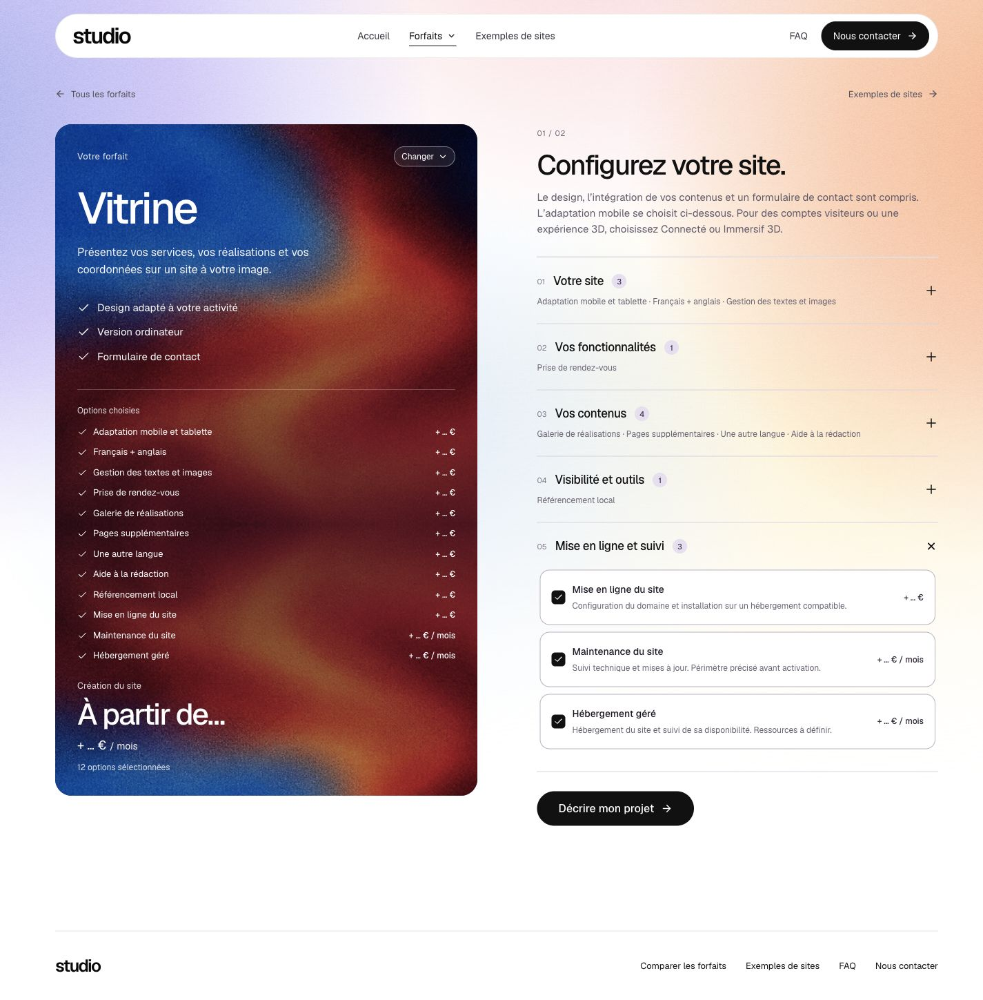
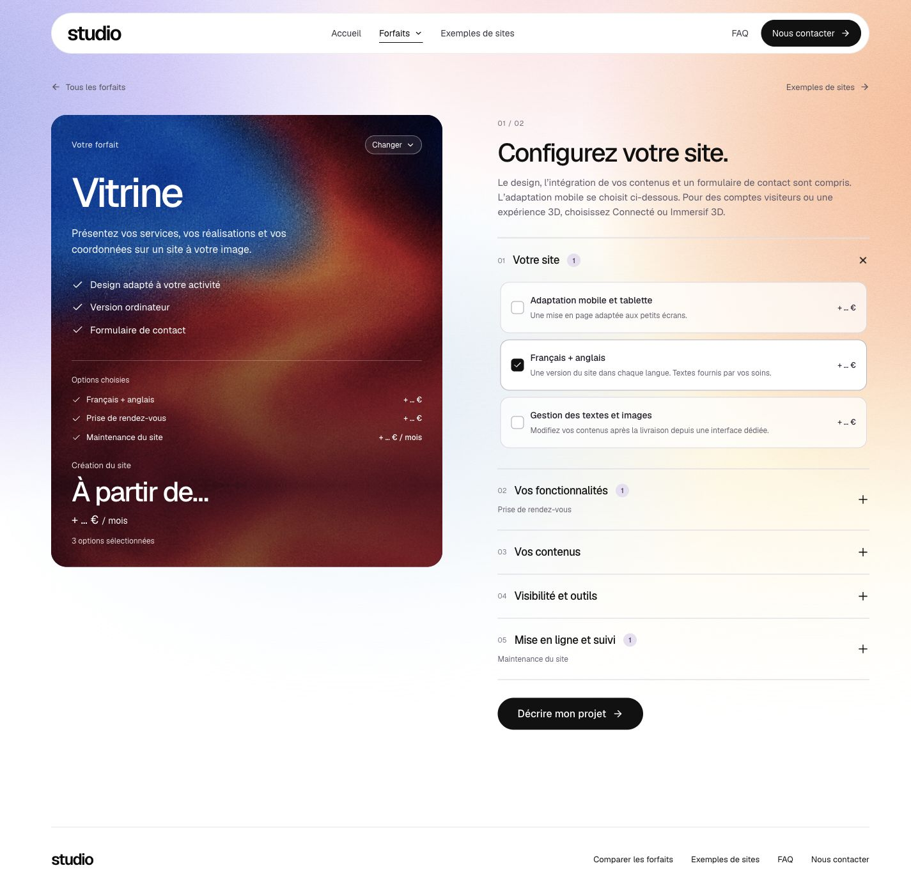
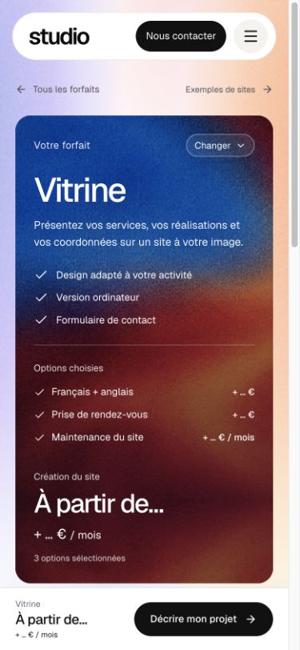

# Image fixe et fond prolongé

4 novembre 2026, date utilisateur. Correction locale vérifiée, publication en préparation.

La clarification de Mathis porte sur l’ajout d’options : conserver la taille de l’image et ajouter du fond sous elle. Le lot précédent vérifiait le cadrage des instantanés natifs, mais le `cover` du fond restait appliqué à une hauteur de carte variable ; il pouvait donc encore zoomer.

## Correction

L’image et sa lumière occupent désormais une bande de hauteur fixe : 580 px dans le format ordinateur contrôlé, 500 px dans le format mobile. Une continuation en miroir vertical prolonge la même texture sous cette bande ; les jonctions utilisent les mêmes pixels de bord. Le nombre de bandes s’adapte à la carte, avec une bande prête sous le cadrage. Aucun fichier d’image n’est modifié ou réexporté.

Les deux instantanés de navigation conservent aussi leur taille propre (`object-fit:none`). Options et hauteur se déplient/se replient en **620 ms**, avec accélération douce ; fondu en 420 ms. Aucune attente ajoutée à la sélection réelle. La réduction des animations reste prioritaire.

## Vérifications locales

- `npm run check` final : TypeScript, build et **213 tests passants**, zéro échec.
- Même viewport 1440 × 900 : carte de 580 px sans option, puis 973 px avec douze options. Première image toujours de **612,1 × 580 px**, à la position 0 dans la carte, pendant toutes les images enregistrées de l’ajout et du retrait.
- Premier ajout : carte de 580 à 620,6 px ; retrait d’une ligne sur la sélection longue : 973 à 943,5 px. Transition de hauteur/position de 620 ms et opacité de 420 ms effectivement observées.
- Contrôle d’une zone de texture sans texte, sur les captures PNG à trois et douze options : mêmes dimensions, écart absolu moyen de 0,27 niveau RVB sur 255. Il ne s’agit pas d’une identité binaire des captures ; les dimensions et l’ancrage restent strictement constants dans les traces DOM.
- Mobile 390 × 844 : carte de 607,3 px à trois options et de 872,8 px à douze ; bande inchangée de **335 × 500 px**. Document/client 375/375, aucun débordement horizontal.
- Accueil → Vitrine : durée 520 ms, ancien et nouvel instantanés tous deux `object-fit:none`.
- Réduction des animations : aucune animation active après rendu, image toujours de 580 px. Console sans erreur/alerte observée.
- Sélection initiale rétablie : français/anglais, rendez-vous et maintenance. Aucun formulaire soumis, aucun fichier ni e-mail envoyé. Viewport et préférence temporaires rétablis.

Traces : `desktop-geometry.json`, `option-enter.json`, `option-exit.json`, `local-interactions.json`, `pixel-comparison-png.json`. Les captures finales enregistrées ci-dessous ont été rouvertes et inspectées. Une capture native ordinateur ne montrant que le fond pastel a été écartée ; la capture pleine page correcte la remplace.

Le contrôle utilise l’IAB sur le vrai build Express avec une base temporaire isolée et un transport e-mail désactivé. Il ne couvre pas tous les navigateurs ou un téléphone physique.
