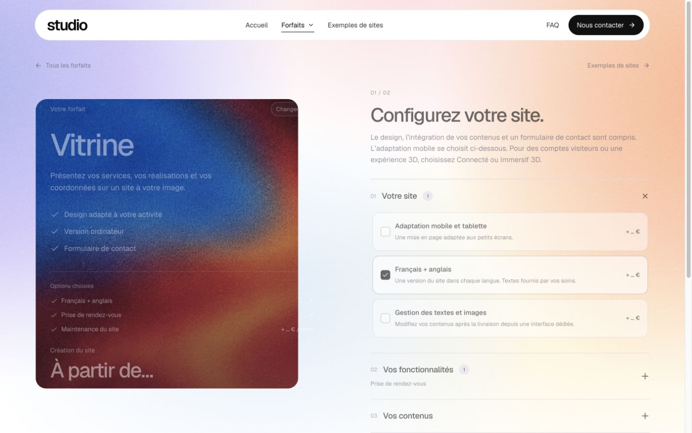
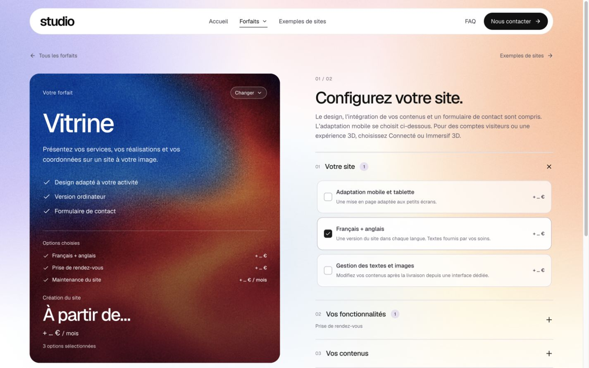
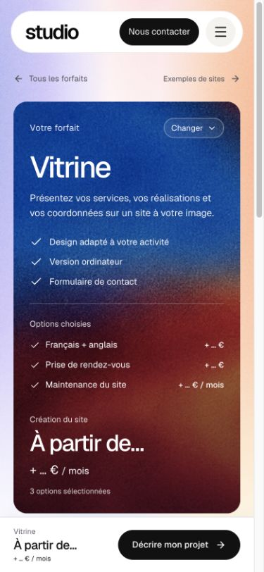

# Fluidité des forfaits — correction après essai public

4 novembre 2026, date utilisateur. Validation locale terminée ; publication en cours. Ce lot corrige le retour de Mathis sur la version `3e8bd12` : agrandissement peu fluide, photo étirée et apparition trop brusque des options.

## Corrections

- Agrandissement de 520 ms, avec accélération progressive et coins interpolés. Le module du configurateur est préchargé au survol ou au focus de sa carte ; le clic n’attend aucune préparation artificielle.
- La grande texture est révélée à sa taille finale dans le cadre mobile (`object-fit:none`), sans redimensionnement de son instantané. La miniature sortante garde son ratio (`cover`). Les fichiers d’images restent intacts.
- Le texte est capturé séparément à sa taille finale, au-dessus de la texture, avec un vrai fondu. La surface ne masque plus le texte jusqu’à la fin de la transition. Le header reste hors des captures ; les navigations rapprochées restent possibles.
- Les lignes d’options gardent leur identité et passent progressivement de 0 à leur hauteur naturelle en 360 ms, avec fondu de 240 ms. Retrait et inversion en cours de mouvement utilisent la même transition CSS. Les lignes non choisies occupent zéro hauteur au repos et sont exclues de l’arbre accessible.
- Premier/dernier choix : le bloc complet se déplie/se replie. Total, compteur, ligne mensuelle, rubriques et passage au brief suivent des transitions courtes. La carte longue continue à quitter sticky.
- La préférence de réduction du mouvement est relue au clic, même si elle a changé depuis le rendu du lien. Elle désactive aussi l’animation des coins du cadre natif.

## Vérification locale

Vrai build Express, base temporaire isolée et transport e-mail désactivé. `npm run check` final : TypeScript, build et **213 tests passants, zéro échec**.

- Ouverture Vitrine : 64 échantillons à vitesse normale, de 291,5 × 196 à 612,1 × 707,4 px, durée native 520 ms. Texture entrante `object-fit:none` pendant tout le mouvement ; opacité du texte de 0 à 1, environ 0,49 à mi-course. Échantillon propre à cet IAB, pas une mesure terrain universelle.
- Capture à 260 ms enregistrée, rouverte et inspectée : coins progressifs et texte visible au-dessus de l’image. Les animations ont été temporairement figées pour cette seule capture puis reprises. Ce fichier ne prétend pas montrer une mesure de vitesse normale.
- Ajout d’une option : hauteur de ligne 0 → 29,5 px, hauteur de carte 707,5 → 737 px, opacité 0 → 1. Retrait inverse réellement observé, avec hauteurs et opacités intermédiaires.
- Premier choix depuis une sélection vide : carte de 580 → 620,6 px, sans apparition instantanée du bloc. Ajouts/retraits rapprochés vérifiés.
- Douze options : carte de 972,9 px, colonne `static`, document/client 1425/1425 dans un viewport 1440 × 900.
- Six destinations atteintes : Vitrine, Connecté, Immersif 3D, Sur mesure, Évolution et Refonte. Séquence rapide Vitrine → Accueil → Connecté : destination finale correcte.
- Mobile 390 × 844 : document/client 375/375, trois options conservées dans la carte. Passage au brief et retour aux options fonctionnels, sans soumission.
- Changement de préférence système après le rendu de l’accueil, puis Entrée sur Vitrine : destination correcte et zéro animation active après rendu.
- Console finale : aucune erreur ou alerte observée. Sélection initiale rétablie (français/anglais, rendez-vous et maintenance), réglages temporaires retirés ; aucune coordonnée saisie, aucun fichier ni formulaire envoyé.

Traces : `navigation-frames.json`, `midpoint-styles.json`, `option-enter-frames.json`, `option-exit-frames.json`, `first-option-frames.json` et `local-interactions.json`.

Référence primaire consultée dans l’IAB : [MDN — ::view-transition-new()](https://developer.mozilla.org/en-US/docs/Web/CSS/Reference/Selectors/::view-transition-new). La validation ne couvre pas tous les navigateurs ni un téléphone physique.
