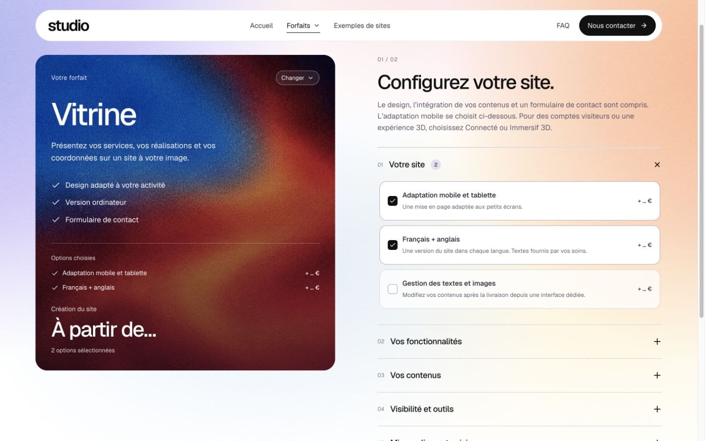

# Publication — animations et options dans la carte

4 novembre 2026 à 21:29, heure de Mexico (UTC−06). Résultat : **publié et vérifié** sur [gilmathis.com](https://gilmathis.com/).

Application `3e8bd12744085a1db59400f6168d2b8ae4089fe3`, poussée sur `main`. Release active `/home/mathis/site-maker/releases/20261105T032011Z-3e8bd1274408` ; précédente release conservée. Le compte rendu documentaire peut avoir un commit ultérieur au code applicatif livré.

## Vérification publique

- L’accueil ouvre Vitrine avec le groupe natif `plan-vitrine`, observé à **420 ms**. La racine garde `view-transition-name:none` ; les contrôles ne font pas partie de la capture décorative.
- Sélection de deux options : leurs libellés et coûts sont directement dans la grande carte, au-dessus du total. Aucun ancien volet `.configurator-selection`.
- Ordinateur 1440 × 900 : document/client 1425/1425. Mobile 390 × 844 : document/client 375/375. Aucun débordement horizontal observé ; captures enregistrées puis rouvertes et inspectées.
- Les choix de contrôle ont été retirés pour rétablir exactement la sélection initiale. Aucun formulaire soumis, aucune pièce jointe, aucun e-mail. Aucune erreur ou alerte de console observée. Viewport temporaire retiré ; accueil public conservé pour les essais de Mathis.

La validation locale plus large couvre les six destinations, douze options, clics rapides, clavier, Cmd+clic, reduced motion et garde du brief : [rapport local](design-qa.md). Ce contrôle public dans l’IAB ne constitue pas un essai exhaustif de tous les navigateurs ou d’un téléphone physique.

## Déploiement et intégrité

`npm run check` relancé avant livraison : TypeScript, build et **213 tests passants**. Sauvegarde Ubuntu réussie avant bascule ; dépendances de production installées depuis le lockfile avec Node 24 du projet, Sharp vérifié par encodage/décodage réel. Archive contrôlée par SHA-256 avant extraction ; bascule atomique de `current`, puis redémarrage du seul service applicatif. Santé valide à l’origine et par HTTPS.

Client public `index-BmzQDKQw.js`, SHA-256 `3807c667b66b744d925a7b032e5db833b16173089af05fe77baba0a2a918726c`. Client, huit CSS et trois textures correspondent au build par HTTPS. Catalogue inchangé ; 25 autres services gardent leur PID, tunnel compris. Aucune modification DNS ou de configuration du tunnel. Données et configuration privées conservées hors de la release ; serveurs locaux arrêtés.

Traces : `deployment-artifact.json`, `deployment-origin.json`, `public-https.json`, `public-browser.json`. Les avis initiaux scellés de l’audit précédent restent intacts.

## Captures publiques

