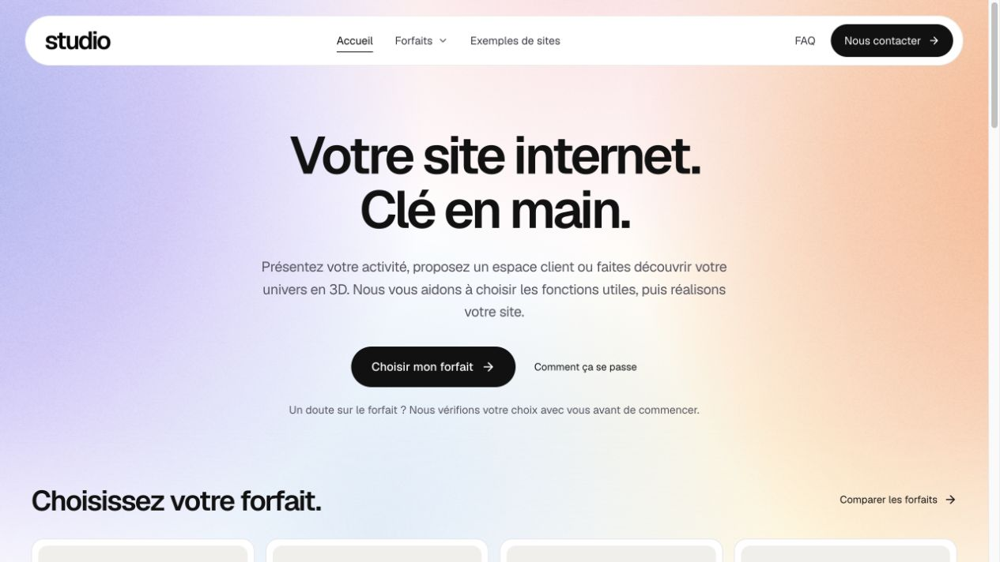
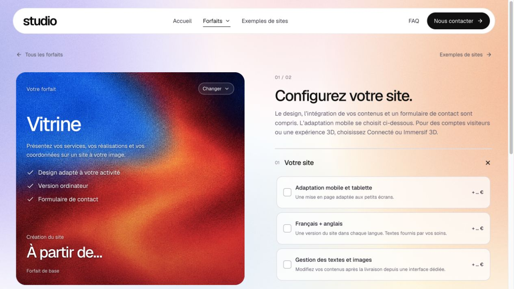
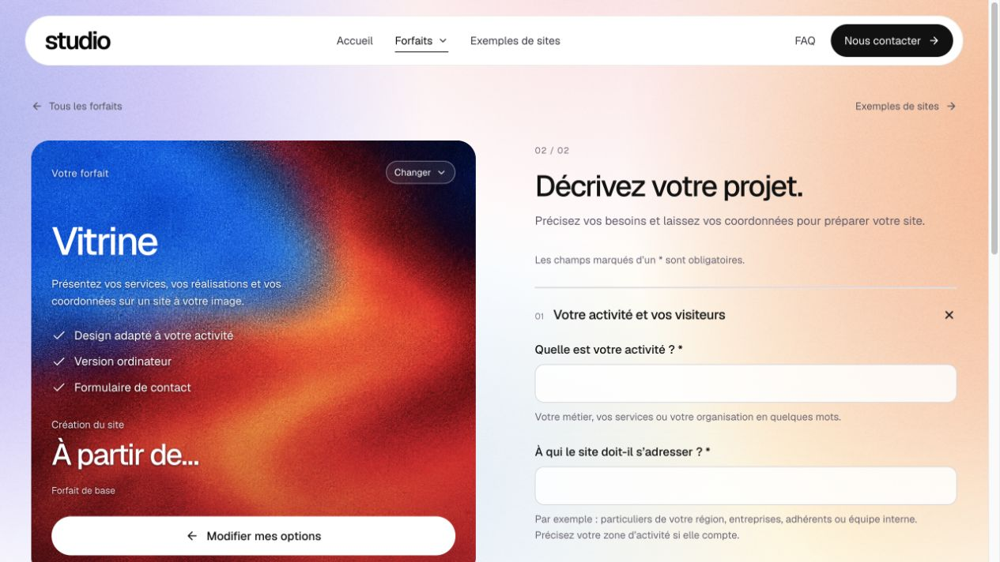
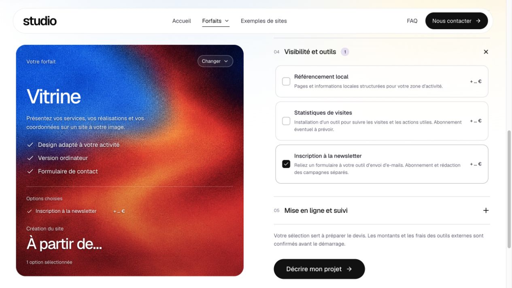

# Revue critique du site et des prix — 5 novembre 2026

## Résultat local

Neuf spécialistes réellement intervenus par vagues : prix comparables France ; catalogue/options manquantes ; parcours/conversion ; périmètres/exploitation ; accessibilité/SEO ; bugs serveur ; bugs interface ; animations ; contre-audit global. Les neuf rapports et les preuves détaillées sont conservés dans le dossier de travail `revue-site-v2-2026-11-05` voisin du dépôt. La contre-revue finale locale ne détecte plus de défaut matériel dans le lot contrôlé. Cette conclusion ne prouve pas une perfection universelle ni une conformité certifiée.

Les prix du premier classeur mélangeaient des petits besoins et des lots plus larges. Le second classeur sépare **ancienne proposition**, **même lot revu** et **entrée simple parfois réduite**. Panel : sept prestataires web français et deux spécialistes 3D, dix références primaires dont une page fiscale du même prestataire. Prix affichés, pas devis signés ni moyenne nationale.

Exemples proposés pour réemploi maîtrisé : page sur modèle 100 €, blog 200 €, première langue de cinq pages avec traductions fournies 350 €, CMS réutilisé 350 €, rédaction simple 120 €. Newsletter 150 € et statistiques 100 € sont des entrées bornées ; la mesure de trois objectifs, les flux CRM robustes et les formulaires codés restent des lots différents. Galerie simple sans filtre, fiche Google seule et formulaire natif ne remplacent pas silencieusement les fonctions plus larges décrites dans le configurateur. Aucun de ces montants n'est publié ni présenté comme approuvé.

Pages primaires recontrôlées : [Donar](https://donar.fr/tarifs), [JD Création Web](https://www.jdcreationweb.fr/tarifs), [Ordas](https://ordas.fr/services/creation-site-wordpress). Les autres sources et limites figurent dans le classeur et le rapport de prix. La comparaison exclut une page 404 et un fournisseur dont la localisation/les conditions ne conviennent pas au panel France.

## Corrections

- Réexposition de newsletter et statistiques sur les quatre créations, avec abonnements éventuels et rédaction des campagnes séparés.
- Autres langues et SEO local disponibles sur les quatre créations ; galerie proposée sur Connecté, avec son CMS déjà compris. Pas de nouveau catalogue parallèle ni de nouvelle clé de prix : les 26 IDs historiques sont conservés.
- Quatre questions facultatives affichées seulement avec leurs options. Une première langue autre que l'anglais est cadrée selon le socle existant ; elle ne reçoit pas automatiquement un prix de langue suivante dans les propositions.
- Une phrase près de l'action explique que la sélection prépare le devis et que montants/frais externes sont confirmés avant démarrage. Contact général n'impose plus implicitement de comparer les forfaits avant d'écrire. La FAQ ne présente plus les sauvegardes masquées comme une case visible.
- Noms UTF-8 préservés dans les uploads privés. Test régressif réellement en échec avant correction, puis nom intact en API, SQLite et téléchargement.
- HTTP 200 HTML/JSON tronqué refusés ; annulations de lecture préservées. Garde du catalogue complet branché sur les deux consommateurs publics, avec repli vers le catalogue non tarifé et message dans le configurateur.
- FAQ contrôlée : grille/fondu 160 ms sur l'enfant de Radix, fermeture accessible immédiatement, inversion sans minuteur, aucun mouvement en préférence réduite. Les six animations de cartes restent inchangées.
- Lien d'évitement vers un main explicitement focusable et noms accessibles contextualisés des liens de galerie ouvrant un nouvel onglet.

## Recette locale

`npm run check` : TypeScript, build et **228 tests passants**, zéro échec. Intégration réelle des quatre créations : enregistrement des nouvelles réponses/configurations et résumé, réponse masquée refusée, zéro tentative de notification externe.

IAB uniquement, aucun Chrome :

1. Accueil → six fiches → retour, ordinateur et 390 × 844 : 24 trajets, pages à opacité 1 et sans largeur débordante. Certains enregistrements de Vitrine finissent avant la fin du raccord ; un état calme indépendant confirme `animations: []`, phase nulle et opacité 1. Aucune fréquence d'images universelle déduite de ces échantillons.
2. Sélection Connecté de 17 choix : titre 50 px et bande d'image 530 px inchangés, résumé en flux sans barre interne. Retrait/réajout rapide : 137 relevés, 106 positions observées et zéro copie résiduelle ; annulation par préférence réduite également propre.
3. FAQ : 40 relevés, hauteurs/opacités intermédiaires au repli ; contenu fermé immédiatement `inert`/`aria-hidden`, puis hauteur zéro/visibilité cachée. Réduction du mouvement : transition absente, texte conservé dans le DOM.
4. Questionnaire vide : premier champ invalide focalisé et bonne rubrique ouverte. Retour aux options et refus de quitter gardent les réponses. Une demande fictive locale réellement enregistrée conserve newsletter/langue/zone, retire la réponse de statistiques désélectionnées et reste avec notification indisponible et zéro tentative.
5. Menu mobile : Échap ferme le dialogue et rend le focus au déclencheur. Lien d'évitement : focus MAIN puis Tab vers le premier lien du contenu. Galerie : filtre Connecté → deux références, compteur annoncé et noms des liens externes contextualisés.

Le classeur révisé comporte deux onglets, 26 options, dix références et 26 écarts calculés sur le même lot. Recalcul testé puis hypothèse restaurée, aucune erreur de formule en cache, export relu indépendamment et trois rendus inspectés.

## Limites et publication

Identité commerciale, conditions précises, tarifs définitifs et destination Resend restent les décisions explicitement différées par Mathis. Aucun renseignement ni secret inventé. Aucune demande ni image de test envoyée en production. Les vérifications locales ne prouvent pas un envoi réel d'e-mail ni les prestations qui seront assurées aux futurs clients.

Version `43b5fce8a17ac30dcb45727d59857842cb5ac049`, release `20261106T035942Z-43b5fce8a17a`, publiée sur https://gilmathis.com/. Sauvegarde préalable réussie ; prix de production et IDs historiques conservés ; 24 autres services gardent PID/état et GP Park répond HTTP 200. Le client `/assets/index-Dv5GqWYT.js` attendu est chargé dans l'IAB public.

Les 24 trajets publics ordinateur/mobile aboutissent avec opacité 1, phase nulle, zéro animation native active et aucun débordement. Les quatre menus réels ont 14/17/14/14 choix. La FAQ publique se replie progressivement (66 relevés, 21 hauteurs), la préférence réduite est contrôlée et la console publique ne contient aucune erreur/alerte observée. Aucun formulaire envoyé en public. Choix publics vides, viewport restauré et localhost arrêté.

Le workflow GitHub reste uniquement manuel. Images originales, arbitrages mobile/mise en ligne, données et anciens dossiers conservés. Les contrôles ne garantissent pas tous les appareils ni la livraison d'un e-mail.

## Captures du parcours

1. **Accueil avant correction — lisible et fonctionnel.**

2. **Options avant correction — fonctions disponibles mais statut du devis peu explicite.**

3. **Questionnaire avant correction — passage et retour fonctionnels ; précisions des nouvelles options ajoutées ensuite.**

4. **Options publiées — newsletter/statistiques accessibles, périmètre et devis explicités.**

