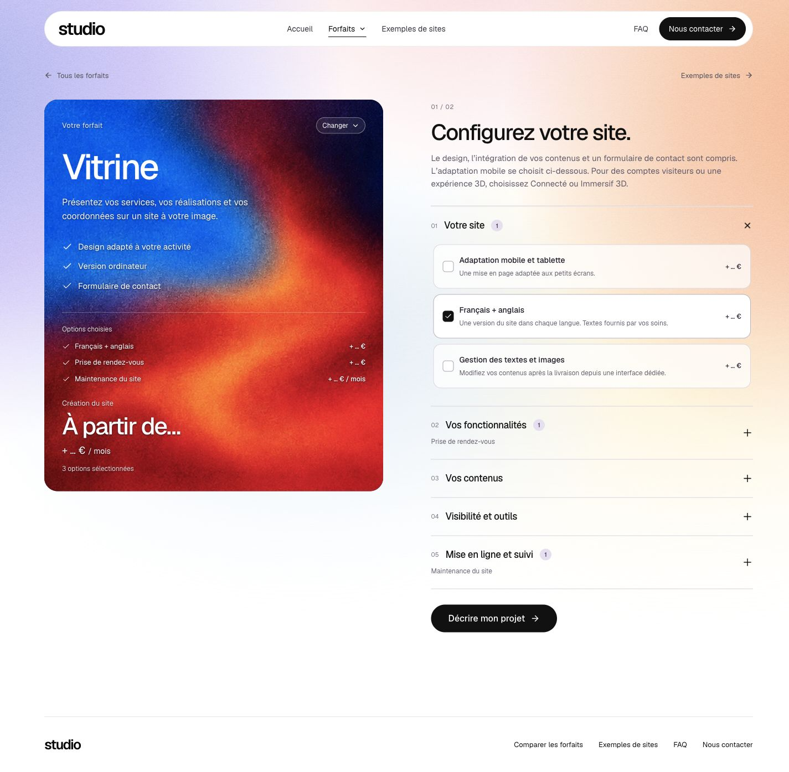

# Essai Vitrine, couleurs et configuration

4 novembre 2026, date utilisateur. Application `3d4d854677066c9779cf7c743e068c92ece3e880` publiée à la demande de Mathis. L’essai fonctionne, mais Mathis refuse ensuite la faible définition de la source générée de 724 px ; la version suivante doit reprendre le master haute définition.

Vitrine utilise seule l’image générée, à échelle fixe, avec une continuité vers le bas sans miroir. Les cinq autres variantes conservent leurs images. La configuration retrouve des couleurs plus vives : suppression de l’assombrissement `brightness(.78)` et voile réduit, avec une ombre de texte discrète pour les petits libellés. Les trois originaux restent identiques octet pour octet.

La carte reste sticky sur ordinateur. Les longues sélections défilent à l’intérieur ; la matière reste dans le cadre. À 1440 × 900, le plafond de la carte est de 720 px. Avec la sélection initiale de trois options, la carte fait 707,5 px et son contenu tient sans défilement résiduel. Le sticky reste borné par la fin de la grille, avant le pied de page. Sur mobile, la carte demeure dans le flux, sans défilement intérieur imposé.

Les cinq rubriques peuvent être ouvertes en même temps ; chacune se referme indépendamment. Ce changement concerne les options du configurateur, pas la FAQ ni les questionnaires.

`npm run check` final : TypeScript, build et 213 tests réussis. IAB local : cinq rubriques ouvertes, douze options, carte à y=112 aux scrolls 360 et 720, défilement intérieur réel, mobile sans débordement et sélection initiale restaurée. Le contrôle numérique initial du sticky utilise le plafond intermédiaire de 696 px ; le plafond final de 720 px évite une barre de défilement pour la sélection initiale. Capture finale remplacée après ce dernier ajustement.

Génération : outil intégré, source et consigne dans [vitrine-trial-prompt.md](../../asset-sources/textures/vitrine-trial-prompt.md). Source 724 × 2172 ; WebP de 433 004 octets dans `public/assets/textures/grain-plasma-vitrine-trial.webp`. Pas d’approbation supposée pour remplacer les autres textures.

## GitHub Actions

Le [run 41968746233](https://github.com/veloci11/Site_maker/actions/runs/41968746233), lié à `e6cf6f7`, n’a pas démarré : annotation GitHub indiquant un compte bloqué pour un problème de facturation. Aucun test distant n’a été exécuté sur ce run. Les 213 tests mentionnés ici sont locaux. Le fichier CI n’a pas été modifié pour masquer ce blocage.

## Suite autorisée

Améliorer nettement les transitions aller-retour entre les listes et les six fiches. Ce travail n’est pas déclaré terminé par ce premier essai visuel.

## Publication de l’essai

Release `20261105T050156Z-3d4d85467706`. Sauvegarde réussie, Sharp et archive contrôlés avant bascule ; santé valide et catalogue inchangé. Les 25 autres services gardent leur PID, tunnel compris. IAB public : nouvel asset Vitrine, absence de `brightness(.78)`, carte sticky, trois rubriques simultanément ouvertes, aucune erreur/alerte observée et aucun envoi. Traces dans `deployment-artifact.json`, `deployment-origin.json` et `public-checks.json`. La capture pleine page faite après un scroll de contrôle n’est pas retenue comme preuve de la position initiale du header.
